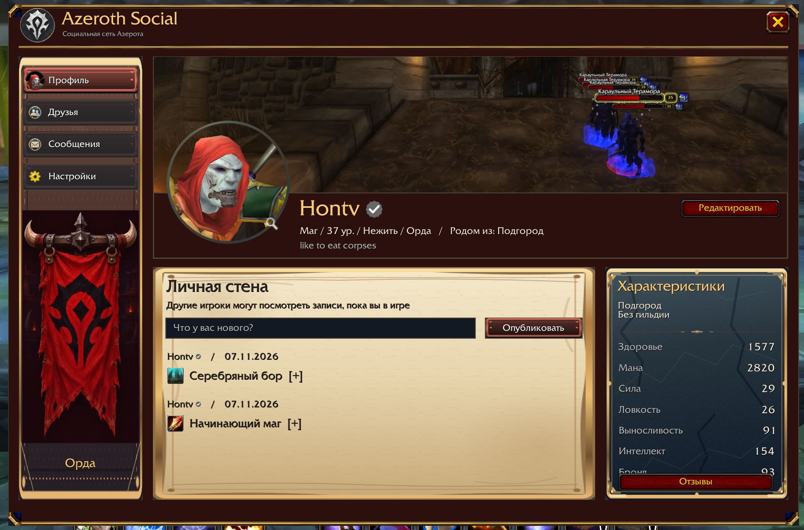

# Azeroth Social · WoW Forever

**Azeroth Social is an addon for WoW Forever.**

[Download the latest ZIP](https://github.com/localhost1989/AzerothSocial/releases/latest/download/AzerothSocial-Forever.zip)

Azeroth Social gives your character a profile, a personal wall and an inbox inside WoW Forever. After a good dungeon run, open **Friends → Recently played** to find your group, message someone or leave a review. The addon uses the language of your game client. Russian and English are included.

| Open | What you can do |
| --- | --- |
| Profile | Click your portrait to see your character in full gear, rotate the model and check stats and professions. Edit your bio, hometown and cover. Horde and Alliance have their own default artwork. |
| Personal wall | Write a post. Optional automatic posts record earned achievements and the first recorded victory over each dungeon boss. Click an achievement for its details. Visitors can request the five latest posts while you are online and sharing. |
| Friends | Find a WoW, Battle.net or saved contact. Search by character name or Name-Realm. Recently played combines the game's recent allies with group and raid members observed locally in the last 30 days. Add a contact, start a conversation or send the download link. |
| Player reviews | Open Reviews on a character's card, then write a short comment about playing together. Both players need version 0.2.20 or later. The recipient must be online with profile sharing enabled. One review per author and character. Sending another updates the original. The owner can see up to 40 reviews, visitors the five latest. Blocking an author hides their reviews from the owner's shared list. |
| Groups | Create a named group for up to eight characters, including its creator. The creator invites online players by Name-Realm. Members can accept or decline, leave, and refresh the roster when the creator is online. Groups persist across reloads. Participants need version 0.2.21 or later. |
| Messages | Open an existing conversation, or choose Message on a friend's card to start one. The envelope by the game chat shows unread messages. Addon messages between online characters show delivery confirmation. Battle.net contacts also support Battle.net whispers. Up to 100 messages per conversation are saved locally. |
| Settings | Profile sharing starts off. Enable it to let others request your profile, wall and reviews. You can also turn off achievement posts and manage blocked characters. |

**Install.** Extract the `AzerothSocial` folder into `_forever_/Interface/AddOns/`. Open the game and type `/as` or click the faction emblem on the minimap. If updating while logged in, use `/reload`.

**Custom cover.** On Windows, open `AzerothSocial/Windows/ImportCover.exe`. On Mac, open the cover importer in the ZIP's `macOS` folder. Choose a photo and restart WoW. Open **Edit profile → Change cover → Custom cover → Select area**, drag to frame the image and save. Your custom photo is visible on your own computer.

Project concept and product direction by [localhost1989](https://github.com/localhost1989). [Authorship and rights](https://github.com/localhost1989/AzerothSocial/blob/main/NOTICE.md).
