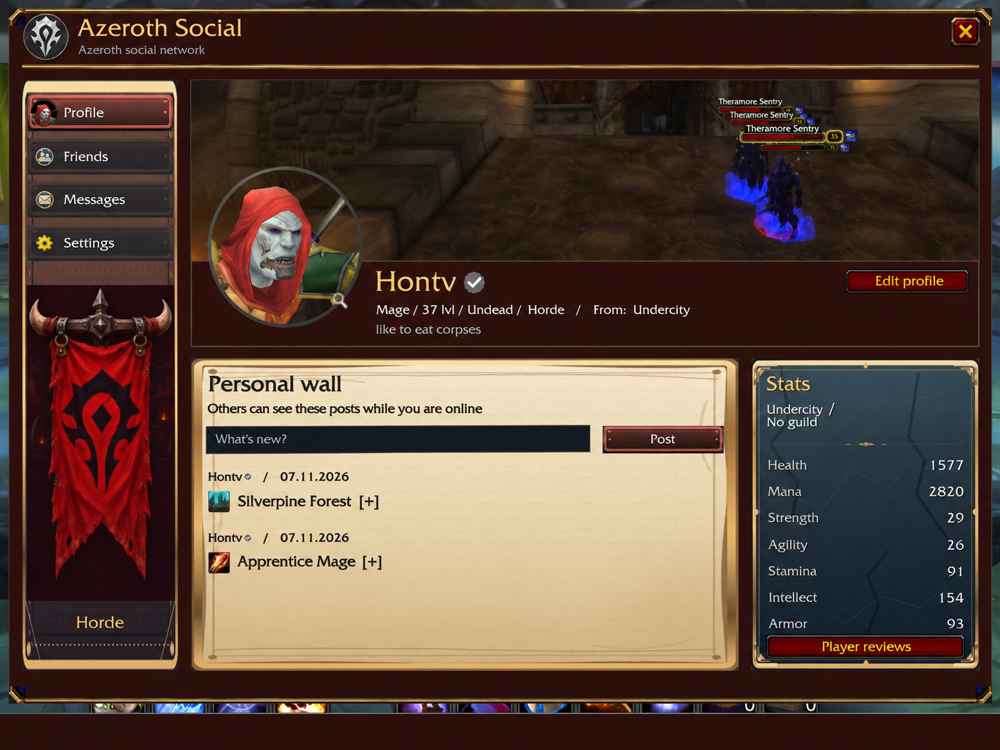
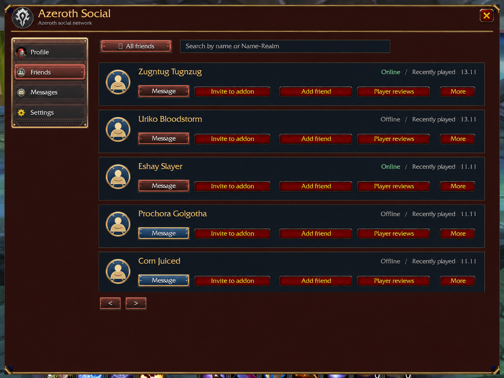

# Azeroth Social · WoW Forever

**Azeroth Social is an addon for WoW Forever.**

[Download the latest ZIP](https://github.com/localhost1989/AzerothSocial/releases/latest/download/AzerothSocial-Forever.zip)

**New in 0.2.26.**

- **Communities**, like groups on Facebook. Open **Communities** for a catalog of ready topics: Fishing, Crafting & Auction House, Looking for Dungeon Group, Raids, PvP, Guild Recruitment and Help for Newcomers. Players can create their own communities too. Each one has a feed with comments, likes and item links, a live chat and a list of members online. Posts travel between online players who have the addon on your realm and faction. A newcomer receives the latest posts from any member online.
- **Profiles for party.** When you are in a group, a **Profiles for party** button appears under the minimap. One click makes an Azeroth Social profile for every party or raid member and invites them in group chat. When one of them installs the addon and you meet again in a group or a guild, the profile is handed over. It becomes theirs and you become friends. Drag the button to move it. **Friends → Invite party** does the same.
- **Acquaintances.** Point at a player to see how many dungeon and raid runs you shared, where the last one was, your rating and your own note. Add a note from the player's right-click menu or with `/as note`. `/as meet` turns these lines off.
- **Ready on first login.** A new player's profile is created automatically, and the addon names who they played with recently.

**0.2.24.** On first login, open your character profile from the welcome prompt. Any member can choose **Friends → Invite party** to share the download link with their current party or raid.

**0.2.23.** Friends appear first, followed by up to five recent teammates. An addon invitation links to the [Wago download page](https://addons.wago.io/addons/azerothsocial). Choose **Share** beside the close button on your profile to send your bio and a full-length outfit card to another character. Both players need 0.2.23 for the 3D card. Older versions receive the text.

Azeroth Social gives your character a profile, a personal wall, an inbox and communities inside WoW Forever. After a good dungeon run, open **Friends → Recently played** to find your group, message someone or leave a review. The addon uses the language of your game client. Russian and English are included.

| Open | What you can do |
| --- | --- |
| Profile | Click your portrait to see your character in full gear, rotate the model and check stats and professions. Edit your bio, hometown and cover. Horde and Alliance have their own default artwork. |
| Personal wall | Write a post. Optional automatic posts record earned achievements and the first recorded victory over each dungeon boss. Click an achievement for its details. Visitors can request the five latest posts while you are online and sharing. |
| Friends | Find a WoW, Battle.net or saved contact. Search by character name or Name-Realm. Recently played combines the game's recent allies with group and raid members observed locally in the last 30 days. Add a contact, start a conversation or send the download link. |
| Player reviews | Open Reviews on a character's card, then write a short comment about playing together. Both players need version 0.2.20 or later. The recipient must be online with profile sharing enabled. With version 0.2.22 on both sides, mark a review with a red Dislike or a green Like. A rating can be sent on its own. One review per author and character. Sending another updates the original. The owner can see up to 40 reviews, visitors the five latest. Blocking an author hides their reviews from the owner's shared list. |
| Communities | Join a ready topic or create your own with a name, description and icon. Write posts with item links, comment, like and chat with members. See who is online in each community. Requires version 0.2.26 on both sides. |
| Messages | Open an existing conversation, or choose Message on a friend's card to start one. The envelope by the game chat shows unread messages. Addon messages between online characters show delivery confirmation. Battle.net contacts also support Battle.net whispers. Up to 100 messages per conversation are saved locally. |
| Settings | Profile sharing starts off. Enable it to let others request your profile, wall and reviews. You can also turn off achievement posts and manage blocked characters. |

**Commands.** `/as` opens the window. `/as note text` saves a note about your target. `/as meet` turns acquaintance lines off or on. `/as net` shows whether the communities channel is connected and who is online. `/as bug` prepares a bug report.

**Install.** Extract the `AzerothSocial` folder into `_forever_/Interface/AddOns/`. Open the game and type `/as` or click the faction emblem on the minimap. If updating while logged in, use `/reload`.

**Custom cover.** On Windows, open `AzerothSocial/Windows/ImportCover.exe`. On Mac, open the cover importer in the ZIP's `macOS` folder. Choose a photo and restart WoW. Open **Edit profile → Change cover → Custom cover → Select area**, drag to frame the image and save. Your custom photo is visible on your own computer.

Project concept and product direction by [localhost1989](https://github.com/localhost1989). [Authorship and rights](https://github.com/localhost1989/AzerothSocial/blob/main/NOTICE.md).

## Usage analytics and bug reports

Players who enable analytics in Wago App can contribute usage statistics. The addon works without Wago App. Custom events use fixed action names and numbers. They contain no message text, character names or coordinates. Wago handles its own session metadata.

Open Settings and select **Report a bug**, or type `/as bug`. Copy the link into your browser and complete the GitHub issue.

For maintainers, compare the number of participating sessions at each consecutive `Flow_` step. Open the window, visit Messages, send a message. `Reached_` flags independent actions, and `Count_` records their frequency. `LastAction` is the last observed action within that UI load. Its codes are 1 = Loaded, 2 = WindowOpened, 3 = Profile, 4 = Friends, 5 = Messages, 6 = Groups, 7 = Settings, 8 = FriendAdded, 9 = MessageSent, 10 = CardShared, 11 = WallPost, 12 = GroupCreated, 13 = ReportOpened. A session can end normally at any step.
